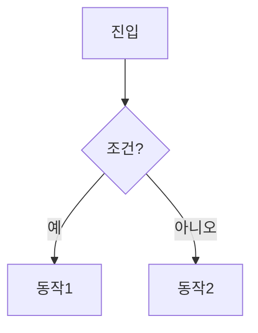

# code-anatomy — 코드 동작명세 생성

## 목적

코드를 읽고 "이 컴포넌트/모듈/기능은 **이렇게 동작한다**"를 **재현 가능하고 사실에 근거해**
문서화한다. 산출물은 **분석 레벨**로 구조를 나누고, 각 **책임(기능)** 을 **6칸 동작명세**로 펼치며,
**한눈에 보는 다이어그램**(구조·흐름)을 곁들인 문서다. 추측이 아니라 코드에서 뽑은 사실(`path:line`)만 담는다.

이 스킬은 "무엇이 있나(정적 지도)"에서 멈추지 않고 "어떻게 행동하나(동작 정책·생애·엣지)"까지 적는다.

## 입력

`$ARGUMENTS` = `<대상 경로> [옵션]`
- **대상 경로**: 분석할 레포 루트 · 디렉터리 · 단일 파일. (필수)
- `--out <경로>`: 문서 저장 경로. 생략 시 기본 `<대상레포>/docs/anatomy/<대상명>.md`.
- `--scope <하위경로,...>`: 대상 중 일부만 분석.
- 인자 없음 → 이 스킬이 무엇을 하는지(분석 레벨·6칸·다이어그램·병렬 분석)를 요약하고 대상 경로를 요청한 뒤 종료.

## 핵심 원칙 (이 스킬의 계약)

1. **사실 기반** — 모든 서술과 다이어그램의 노드·엣지는 코드 근거 `path:line` 를 동반한다.
   근거 없는 서술·노드는 그리지 않고, 불가피하면 `[추론]` 또는 `[근거부족]` 으로 명시한다(GUIDE_CORE 참고). 코드 인용은 원문 그대로.
2. **재현성** — 같은 대상·같은 커밋이면 **같은 구조·같은 사실**이 나오도록 아래 고정 절차·
   고정 추출 규칙·고정 정렬을 따른다. 문서 상단에 **커밋 해시**를 박아 재현 기준을 남긴다.
3. **요약 없이 전달** — 서브에이전트는 분석 결과(6칸 + 근거 + 다이어그램)를 **요약·생략하지 않고 완전하게** 반환하고,
   메인은 그것을 **요약하지 않고 그대로 문서에 편입**한다(재작성 금지). 규모가 커 반환이 과대하면
   서브에이전트가 자기 섹션을 **조각 파일로 쓰고** 메인은 파일을 이어붙인다(내용 손실 0).
4. **로직 보존** — 분석만 한다. 대상 코드는 고치지 않는다. 문서 파일 생성은 사용자 승인 후.

---

## 개념 정의 (canonical)

### 분석 레벨 (가변 깊이)

```
시스템(System)      분석 대상 전체 — 레포/코드베이스
  컴포넌트(Component) 경계·응집을 가진 논리 단위 — 패키지·서비스·라이브러리 (C4 Component; UI 위젯 아님). 중첩·생략 가능
    모듈(Module)      관련 책임을 묶은 파일(들)
      책임(Responsibility) 하나의 일 = 기능. 6칸 동작명세의 단위
        함수/클래스(Function/Class) 책임을 구현하는 수단
          자료구조/문(Data structure/Statement) 원시 단위
```

- **고정 6층이 아니다.** 대상에 실재하는 레벨만 골라 쓰고 없는 층은 건너뛴다.
  - 단일 스크립트: 시스템(파일) → 책임 → 함수.
  - 소형 라이브러리: 시스템(레포) → 모듈 → 책임 → 함수 (컴포넌트 없음).
  - 대형 시스템: 시스템 → 컴포넌트 → (하위 컴포넌트) → 모듈 → 책임 → 함수.

### 6칸 동작명세 (책임 1개당)

| # | 항목 | 답하는 질문 | 코드에서 보는 곳 |
|---|---|---|---|
| 1 | 책임 (Why) | 왜 존재하나 / 무슨 문제를 없애나 | docstring, 함수·모듈명 |
| 2 | 자료구조 (Shape) | 어떤 모양의 데이터인가 (타입·키·값) | `@dataclass`, dict/list 선언, 타입주석 |
| 3 | 소유·수명 (State) | 누가 들고 언제 생기고 사라지나 | `self._x`, 모듈 전역, 파일/DB(영속) |
| 4 | 동작 정책 (Behavior) | 어떤 규칙으로 행동하나 (조건 분기) | 함수 본문 `if/return/raise` |
| 5 | 경계·트리거 (Trigger) | 무엇이 이 상태/동작을 바꾸나 | 함수 인자, 호출 지점, env·요청 입력 |
| 6 | 실패·엣지 (Edge) | 언제 깨지나 / 무엇을 안 하나 | `except`, 누락 케이스, TODO, 무한증식·키 불일치 |

1~3 = 정적(상태·자료구조 지도) / 4~6 = 동적(동작). 여섯 칸을 다 채워야 "이렇게 동작한다"가 완성된다.

### 다이어그램 카탈로그 (mermaid)

다이어그램도 **코드에서 도출한 사실만** 그린다. 각 다이어그램은 이미 뽑은 분석레벨·6칸 데이터의 시각화다.

| 다이어그램 | 답하는 질문 | 레벨 | mermaid 타입 | 근거 소스(코드) | 필수 |
|---|---|---|---|---|---|
| 구조 지도 | 어떤 기능이 어디 있나 | 시스템→모듈→책임 | `graph TD` | 분석 레벨 + 책임 목록 | 필수 |
| 실행 흐름 | 프로그램이 어떻게 흐르나 | 컴포넌트 | `flowchart LR` | 진입점의 호출 순서 | 필수 |
| 데이터 흐름 | 데이터가 어떻게 변하나 | 모듈 | `flowchart LR` | 함수 입출력 타입 + DTO 목록 | 권장 |
| 의존 관계 | 뭐가 뭘 부르나 | 모듈 | `graph LR` | import 문 + 호출부 | 권장 |
| 결정 분기 | 이 기능은 언제 뭘 하나 | 책임 | `flowchart TD` | 6칸의 4번(동작 정책) if/return | 선택(if 2개↑인 책임만) |
| 상태 생명주기 | 상태가 언제 생기고 죽나 | 책임 | `stateDiagram-v2` | 6칸의 3번(소유·수명) | 선택(상태 보유체만) |

**다이어그램 재현성·가독성 규칙**
1. 근거 없는 노드·엣지 금지. 노드=실제 모듈/책임/함수, 엣지=실제 호출/의존/분기.
2. 노드 수 상한 한 그림 20개. 넘으면 레벨을 나눠 여러 장으로.
3. 방향 고정 — 흐름=`LR`, 구조=`TD`. (정렬처럼 방향도 고정해야 재현된다)
4. 라벨은 GUIDE_CORE 용어 규칙 적용(억지 번역·비유 직역 금지).
5. 선택 다이어그램은 조건부 — 결정분기는 4번 칸 if 2개 이상, 생명주기는 상태 보유체에만.

---

## Step

### Step 0 — 재현 기준 고정

1. 대상 경로 확정. git 레포면 커밋 해시를 기록한다: `git -C <대상> rev-parse --short HEAD` (아니면 "no-git").
2. 대상 규모 측정(병렬 분석 판단 근거):
   ```bash
   # 소스 파일 수·라인 수 (언어에 맞게 확장자 조정)
   find <대상> -type f \( -name '*.py' -o -name '*.ts' -o -name '*.js' -o -name '*.go' -o -name '*.java' \) \
     -not -path '*/.git/*' -not -path '*/node_modules/*' | wc -l
   find <대상> -type f \( -name '*.py' -o -name '*.ts' \) -not -path '*/.git/*' | xargs wc -l | tail -1
   ```
3. 대상 경로·커밋·규모를 1줄로 보고한다.

### Step 1 — 분석 레벨 판별 (실재하는 레벨만)

1. **컴포넌트 층 존재 여부**: 대상 아래 응집 단위 디렉터리(패키지)를 찾는다.
   ```bash
   find <대상> -maxdepth 2 -name '__init__.py' -o -maxdepth 2 -name 'package.json' -o -maxdepth 2 -name 'go.mod'
   # 최상위 소스 디렉터리 (src/*, agents/*, services/*, lib/* 등)
   ```
   - 응집 단위가 2개 이상 → 컴포넌트 층 있음. 1개/없음 → 컴포넌트 생략(시스템=단일 컴포넌트).
2. **모듈**: 각 컴포넌트(또는 시스템) 아래 소스 파일 목록. **경로 사전순**으로 고정 정렬.
3. 탐지된 레벨과 트리를 정리한다(문서 §2 가 됨).

### Step 2 — 책임(기능) 추출 규칙 (재현성)

모듈마다 책임을 뽑는다. 다음 순서로, 근거와 함께:

1. **모듈 docstring 이 책임을 나열하면 그대로 채택**(예: "① 선택 ② 캐시 ③ 재fetch"). 순서 보존.
2. 없으면 코드에서 추출:
   ```bash
   grep -n "@dataclass\|^class \|^def \|^    def " <모듈>        # 클래스·함수 = 책임 후보
   grep -n "self\._" <모듈>                                      # 인스턴스 상태
   grep -nE "^_[a-z].* = (\{\}|\[\]|set\(\))" <모듈>             # 모듈 전역 상태
   ```
   - 응집된 함수·클래스 군집을 하나의 책임으로 묶는다. 순수 DTO 정의 모듈은 책임 대신 §5 인벤토리로.
3. 책임 목록을 **선언 순서**로 고정한다(문서 §3 목록).

### Step 3 — 병렬 분석 결정 + 분석 실행

**판단 기준(고정)**: 모듈 수 ≤ 6 **그리고** 총 LOC ≤ 1500 → 메인이 직접 분석(Step 4).
그 외 → **서브에이전트 병렬 분석(팬아웃)**:

1. **분할 단위**: 컴포넌트 1개당 서브에이전트 1개. 컴포넌트가 없으면 모듈을 균등 그룹으로 묶어 그룹당 1개.
   컴포넌트가 아주 크면(모듈 > 12) 그 안에서 모듈 그룹으로 재분할.
2. **각 서브에이전트에 주는 지시(요약 없이 전달 계약)** — 아래를 그대로 전달한다:
   > 담당 스코프: `<경로들>`. 이 스코프의 각 모듈에 대해 **Step 2 규칙으로 책임을 나열**하고,
   > 각 책임을 **6칸 동작명세**로 작성하라. **모든 칸에 `path:line` 근거와 필요한 코드 원문 인용**을 넣어라.
   > **요약·생략 금지** — 발견한 사실을 완전하게 담아라. 상태·자료구조는 §5 인벤토리 형식으로도 반환하라.
   > 조건을 만족하는 책임에는 **결정 분기(4번 칸 if 2개 이상)·상태 생명주기(상태 보유체) 다이어그램**을 근거 기반 mermaid 로 6칸 표 아래에 포함하라.
   > 반환은 아래 "출력 문서 템플릿"의 §3·§4·§5 조각(마크다운)으로 하라. 확인 못 한 것은 `[근거부족]` 표기.
   > **책임 번호는 모듈-로컬 임시 번호(1,2,3…)로만 매기고 그룹 라벨(A/B/C)을 붙이지 마라.** 전역 연속 번호(`4.N`)는 메인이 조립 시 모듈 경로 사전순→선언순으로 재부여한다. (GUIDE_CORE "번호 매기기" 규칙)
   > 스코프가 커 반환이 과대하면 `<out-dir>/_fragment_<스코프명>.md` 로 직접 쓰고 그 경로만 반환하라.
3. **메인의 조립**: 서브에이전트가 반환/기록한 조각을 **요약하지 않고 그대로** 문서 섹션에 편입한다.
   조각 파일은 경로 사전순으로 이어붙인다. 메인은 §1·§2(분석 레벨)·§2.5(구조·흐름 다이어그램)·§3 목록·§6(근거부족 집계)를 생성하고,
   **책임에 전역 연속 번호(`4.1`..`4.N`, 모듈 경로 사전순→선언순)를 재부여**한다(그룹 라벨 노출 금지). §3 목록과 §4 헤딩은 같은 번호를 쓴다.

### Step 4 — 6칸 동작명세 + 다이어그램 작성

책임마다 §4 항목을 만든다. **6칸 전부** 채우고, 각 칸에 근거를 단다.
- 4번(동작 정책)은 함수 본문의 **분기 조건을 코드로 인용**해 "언제 무엇을 하는지"를 명시한다.
- 6번(엣지)은 `except`·누락 케이스·TODO·무한증식(TTL 없음)·키 불일치 등을 적극적으로 찾는다.
- 확인 못 한 칸은 비우지 말고 `[근거부족]` 으로 남긴다.
- 조건 충족 시 6칸 표 아래에 **결정 분기 / 상태 생명주기** 다이어그램을 붙인다(다이어그램 규칙 준수).

### Step 4.5 — 전체 조망 다이어그램 (메인 담당)

메인은 §2.5 에 **필수 2개**를 그린다. 근거는 위에서 확정한 사실:
- **실행 흐름**(`flowchart LR`): 진입점(오케스트레이터)의 실제 호출 순서 그대로.
- **구조 지도**(`graph TD`): 분석 레벨 + 책임 목록을 시스템→모듈→책임 트리로.
- 권장 시 데이터 흐름·의존 관계도 추가.

### Step 5 — 문서 조립·저장

1. 아래 템플릿으로 문서를 조립한다. 저장 경로는 `--out` 또는 기본값.
2. **저장 전 사용자에게 미리보기(목차 + 책임 수 + 다이어그램 수 + 저장 경로)를 보이고 승인**을 받는다.
3. 승인 후 파일 생성. 조각 파일은 조립 후 삭제한다.
4. Self-Check 출력.

---

## 출력 문서 템플릿 (고정)

````markdown
---
title: <대상명> 동작명세 (code anatomy)
target: <대상 경로>
commit: <해시 또는 no-git>
date: <YYYY-MM-DD>
generator: /code-anatomy v1.2
---

# <대상명> 동작명세

## 1. 대상·재현 정보
- 경로 / 커밋 / 규모(파일 수·LOC) / 분석 방식(직접 or 서브에이전트 N개)

## 2. 분석 레벨
- 탐지된 레벨 + 트리 (시스템 → 컴포넌트 → 모듈 …). 생략된 층은 이유 1줄.

## 2.5 구조·흐름 다이어그램
- 실행 흐름 (flowchart LR): 진입점 호출 순서
  ```mermaid
  flowchart LR
    Q[입력] --> s1[단계1] --> s2[단계2] --> R[출력]
  ```
- 구조 지도 (graph TD): 시스템 → 모듈 → 책임
  ```mermaid
  graph TD
    S[시스템] --> M1[모듈A]
    M1 --> R1[책임1]
    M1 --> R2[책임2]
  ```

## 3. 책임 목록
- 모듈 소제목별 책임 목록. 번호는 전역 연속 정수(§4 와 동일). 각 항목 → §4.

## 4. 책임별 6칸 동작명세
<!-- 책임 번호: 문서 전체 연속 정수 4.1..4.N. 모듈 경로 사전순 → 선언순. 그룹 라벨(A/B/C) 금지. 병렬 분석 시 메인이 조립 때 재부여 -->
### 4.<번호> <모듈> / <책임명>
| # | 항목 | 내용 (근거 path:line) |
|---|---|---|
| 1 | 책임 | ... |
| 2 | 자료구조 | ... |
| 3 | 소유·수명 | ... |
| 4 | 동작 정책 | ...(분기 조건 코드 인용) |
| 5 | 경계·트리거 | ... |
| 6 | 실패·엣지 | ... |

(조건 충족 시) 결정 분기 또는 상태 생명주기:


## 5. 상태·자료구조 인벤토리 (부록)
- DTO 종합표(이름 / 필드 / 위치)
- 상태 보유체 종합표(이름 / 소유주체 / 구조(키→값) / 수명 / 위치)

## 6. 근거부족·미확인 항목
- [추론]/[근거부족] 로 표기한 것 집계 — 재분석 시 우선 확인 대상.
````

---

## 재현성 체크 (보증 장치)

- 커밋 해시 고정 → 같은 코드 상태에서 재실행.
- 파일·모듈: **경로 사전순**. 책임: **선언 순서**. 다이어그램 방향: 흐름=LR·구조=TD 고정. (정렬·방향이 흔들리면 diff 가 흔들린다)
- 모든 사실·노드에 `path:line`. 근거 없으면 서술·작도하지 않는다(추측이 재현성을 깬다).
- 병렬 분석 임계값(6모듈/1500LOC)·분할 단위(컴포넌트) 고정.

## Self-Check (보고 전 출력)

```
Self-Check:
- [ ] 한다 체 / 이모지 없음 / 제목 계층·코드펜스 언어 준수
- [ ] 용어: 억지 순우리말 번역·영어 비유 직역 없음 (GUIDE_CORE 용어 규칙)
- [ ] 모든 서술·다이어그램 노드에 path:line 근거 (없으면 [추론]/[근거부족] 표기)
- [ ] 분석 레벨: 실재 레벨만, 생략 사유 명시
- [ ] 책임마다 6칸 전부 채움
- [ ] 책임 번호: 전역 연속 4.1..N(모듈 경로 사전순→선언순), 그룹 라벨 없음, §3=§4 일치
- [ ] §2.5 필수 다이어그램 2개(실행 흐름·구조 지도), 방향·노드수 규칙 준수
- [ ] 서브에이전트 결과 요약 없이 편입(재작성 안 함)
- [ ] 커밋 해시·정렬 고정(재현성)
- [ ] 대상 코드 미변경 / 문서 저장은 승인 후
```
